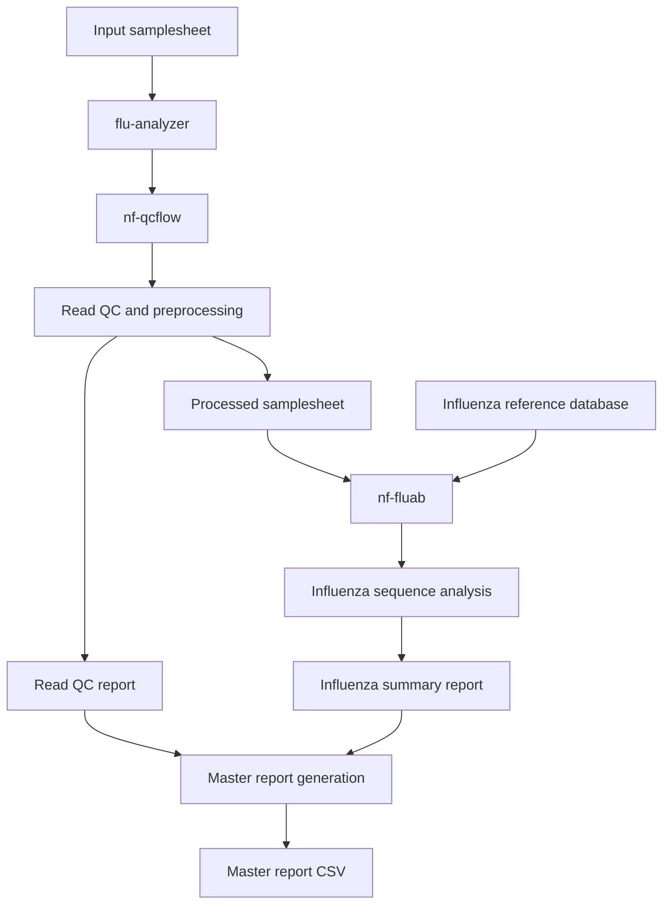

# flu-analyzer

**Integrated influenza A and B NGS analysis pipeline**

`flu-analyzer` is a workflow launcher that integrates read quality control, preprocessing, and influenza sequence analysis using two Nextflow pipelines:

- [nf-qcflow](https://github.com/xiaoli-dong/qcflow) – read quality control and preprocessing.
- [nf-fluab](https://github.com/xiaoli-dong/nf-fluab) – influenza A and B sequence analysis.

The launcher coordinates both workflows, passes the QC-processed samplesheet to the influenza analysis pipeline, and generates a consolidated master report.

Reference database generation is a separate operation managed by [`fluab-reference-db`](https://github.com/xiaoli-dong/fluab-reference-db). The `build_reference_db.sh` wrapper provides an entry point from `flu-analyzer` to that project.

## Workflow overview



The workflow above describes routine sample analysis. Reference database generation is performed separately using `build_reference_db.sh`.

## Features

- Integrated execution of `nf-qcflow` and `nf-fluab`.
- Support for Illumina and Oxford Nanopore sequencing data through the underlying pipelines.
- Configurable development and production environments.
- Configurable Nextflow execution profile.
- Centralized logging and error handling.
- Automatic collection of pipeline and reference database versions.
- Nextflow resume support.
- Consolidated master report combining read QC and influenza analysis results.
- Separate launcher for reference database generation.

## Requirements

- Nextflow >=25.10.4
- Python 3
- Accessible installations of `nf-qcflow` and `nf-fluab`.
- Influenza A/B reference database generated by [`fluab-reference-db`](https://github.com/xiaoli-dong/fluab-reference-db).

Pipeline paths, versions, reference database location, execution profile, and environment-specific settings are configured through the files under `config/`.

## Input

The analysis launcher accepts a CSV samplesheet compatible with `nf-qcflow`.

For example:

```csv
sample,fastq_1,fastq_2,fastq_long
sample01,/data/sample01_R1.fastq.gz,/data/sample01_R2.fastq.gz,NA
sample02,NA,NA,/data/sample02.fastq.gz
```

The samplesheet supports Illumina paired-end and Oxford Nanopore long-read data. The `fastq_long` column is used for long-read input.

Refer to the [nf-qcflow documentation](https://github.com/xiaoli-dong/qcflow) for the complete samplesheet requirements.

## Configuration

The launcher supports two execution environments:

| Environment | Description |
|---|---|
| `production` | Uses production pipeline installations and configurations. |
| `development` | Uses development pipeline installations and configurations. |

The default environment is `production`.

Configuration is divided into:

- `config/dependencies.config` – pipeline dependencies and shared configuration variables.
- `config/environments/production.config` – production environment settings, including the reference database pipeline path.
- `config/environments/development.config` – development environment settings, including the reference database pipeline path.
- `config/pipelines/nf-qcflow.config` – `nf-qcflow` configuration.
- `config/pipelines/nf-fluab.config` – `nf-fluab` configuration.

The reference database project path is configured using `FLUAB_DB_PIPELINE_DIR` in the selected environment configuration.

## Run influenza analysis

Use `run_flu.sh` to perform routine sample analysis using an existing influenza reference database.

### Usage

```bash
# Run the analysis pipeline using production configuration
bash run_flu.sh samplesheet.csv results/

# Run using development configuration
bash run_flu.sh samplesheet.csv results/ --env development

# Display help
bash run_flu.sh --help

# Display version
bash run_flu.sh --version
```

### Command-line options

| Argument | Description |
|---|---|
| `samplesheet.csv` | Input samplesheet for `nf-qcflow`. |
| `results_dir` | Output directory. |
| `--env production` | Use production configuration (default). |
| `--env development` | Use development configuration. |
| `-h`, `--help` | Display usage information. |
| `-v`, `--version` | Display launcher version. |

## Output structure

The analysis launcher organizes results into separate directories:

```text
results/
├── nf-qcflow/
│   └── ...
├── nf-fluab/
│   └── ...
├── master_report/
│   └── master_report.csv
├── logs/
│   └── pipeline.log
└── run_info.txt
```

| Output | Description |
|---|---|
| `nf-qcflow/` | Read QC and preprocessing results. |
| `nf-fluab/` | Influenza sequence analysis results. |
| `master_report/master_report.csv` | Consolidated analysis report. |
| `logs/pipeline.log` | Launcher and pipeline execution log. |
| `run_info.txt` | Run metadata, pipeline versions, and reference database information. |

### Master report

The master report combines:

- Read QC results from `nf-qcflow`.
- Influenza analysis summary results from `nf-fluab`.
- Pipeline version information.

The report is generated as:

```text
master_report/master_report.csv
```

## Logging and reproducibility

Each analysis execution records:

- `flu-analyzer` version.
- `nf-qcflow` version.
- `nf-fluab` version.
- Reference database version and resolved path.
- Selected execution environment.
- Analysis date and input samplesheet.

Nextflow is invoked with `-resume` for both workflows, allowing completed tasks to be reused when the same work directory and task inputs are available.

Execution logs are written to:

```text
results/logs/pipeline.log
```

Run metadata are written to:

```text
results/run_info.txt
```

## Build the influenza reference database

Reference database generation is managed separately by the [`fluab-reference-db`](https://github.com/xiaoli-dong/fluab-reference-db) project.

The `build_reference_db.sh` wrapper in `flu-analyzer` selects the development or production reference database project installation and forwards the remaining command-line arguments to its `bin/run_pipeline.sh` launcher.

Building or updating the reference database is independent of routine sample analysis. This operation does not run `run_flu.sh`.

### Usage

Display available options:

```bash
bash build_reference_db.sh --help
```

Build using the development environment:

```bash
bash build_reference_db.sh --env development --outdir outdir
```

Build using the production environment:

```bash
bash build_reference_db.sh --env production --outdir outdir
```

### Pass options to the reference database pipeline

Arguments other than `--env` are forwarded to `fluab-reference-db/bin/run_pipeline.sh`.

For example, to limit downloads to 500 records per taxon:

```bash
bash build_reference_db.sh \
    --env development \
    --outdir outdir \
    --max 500
```

The reference database launcher supports additional options, including:

| Option | Description |
|---|---|
| `--outdir` | Output directory for the database build. |
| `--batch` | Metadata page size and sequence batch size. |
| `--seq-limit` | Maximum number of sequences per BV-BRC request. |
| `--max` | Maximum number of records per taxon. |

Refer to the [`fluab-reference-db` documentation](https://github.com/xiaoli-dong/fluab-reference-db) for the complete list of supported build options.

The reference database project path is configured separately for each environment using `FLUAB_DB_PIPELINE_DIR` in:

- `config/environments/development.config`
- `config/environments/production.config`

The generated database can then be configured for use by `run_flu.sh` through the corresponding environment configuration.

## Related repositories

- [nf-qcflow](https://github.com/xiaoli-dong/qcflow) – read QC and preprocessing.
- [nf-fluab](https://github.com/xiaoli-dong/nf-fluab) – influenza A/B sequence analysis.
- [fluab-reference-db](https://github.com/xiaoli-dong/fluab-reference-db) – influenza A/B reference database generation.

## Author

Xiaoli Dong  
ProvLab – Alberta Precision Laboratories  
Calgary, Alberta, Canada

## License

MIT License. See [LICENSE](LICENSE) for details.
