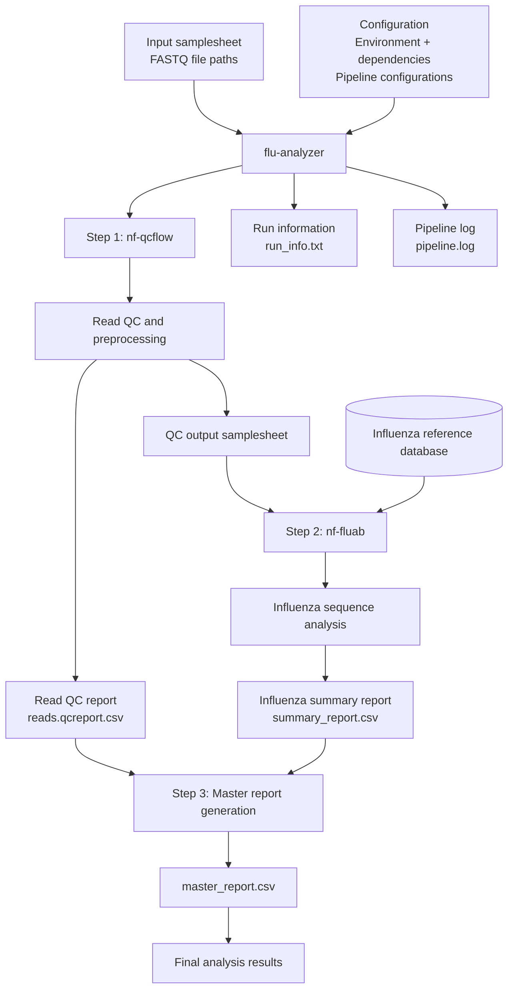

# flu-analyzer

**Influenza NGS analysis pipeline**

`flu-analyzer` is a workflow wrapper that integrates read quality control and influenza sequence analysis using two Nextflow pipelines:

- [`nf-qcflow`](https://github.com/xiaoli-dong/qcflow) – read quality control and preprocessing.
- [`nf-fluab`](https://github.com/xiaoli-dong/nf-fluab) – influenza sequence analysis.

The wrapper runs both pipelines sequentially and combines their reports into a consolidated master report.

## Workflow overview

The workflow consists of four steps:

1. **Read QC (`nf-qcflow`)**
   - Runs read quality control and preprocessing.
   - Generates a downstream samplesheet for influenza analysis.

2. **Influenza analysis (`nf-fluab`)**
   - Uses the samplesheet generated by `nf-qcflow`.
   - Runs influenza sequence analysis using the configured reference database.

3. **Master report generation**
   - Combines the influenza summary report and read QC report.
   - Associates QC results with influenza analysis results using sample and sequencing platform information.
   - Includes pipeline version information.

4. **Run information**
   - Records the analysis date, environment, pipeline versions, Nextflow profile, and reference database release.

## Repository structure

```text
flu-analyzer/
├── build_reference_db.sh
├── config/
│   ├── dependencies.config
│   ├── environments/
│   │   ├── development.config
│   │   └── production.config
│   └── pipelines/
│       ├── nf-qcflow.config
│       └── nf-fluab.config
├── scripts/
│   └── create_master_report.py
├── tests/
│   └── test_data/
│       ├── fastq/
│       └── samplesheet.csv
├── run_flu.sh
├── VERSION
└── README.md
```

## Requirements

- Linux
- Bash
- [Nextflow](https://www.nextflow.io/)
- Python 3
- Conda environment containing Nextflow and the required command-line dependencies
- Access to the `nf-qcflow` and `nf-fluab` pipeline installations
- Access to the influenza reference database
- Appropriate compute resources and a configured Nextflow execution profile

The current deployment uses the `nf-core-4` Conda environment, which provides Nextflow.

### Conda environment

Activate the environment before running the wrapper:

```bash
conda activate nf-core-4
```

Check that Nextflow and Python are available:

```bash
nextflow -version
python3 --version
```

## Configuration

The wrapper uses configuration files under `config/`.

### 1. Dependencies configuration

`config/dependencies.config` defines the locations and versions of the required pipeline dependencies and reference database.

Configure the paths for:

- `nf-qcflow`
- `nf-fluab`
- Influenza reference database
- Pipeline versions
- Reference database version

### 2. Environment configuration

Two execution environments are supported:

- `development.config`
- `production.config`

These files define environment-specific settings, including the Nextflow execution profile and other deployment settings.

The default environment is `production`.

### 3. Pipeline configurations

The following configuration files provide pipeline-specific parameters:

- `config/pipelines/nf-qcflow.config`
- `config/pipelines/nf-fluab.config`

Review these configurations to ensure that the settings are appropriate for the intended analysis environment.

## Usage

```bash
./run_flu.sh <samplesheet.csv> <results_dir> [options]
```

### Arguments

| Argument | Description |
|---|---|
| `samplesheet.csv` | Input samplesheet for `nf-qcflow` |
| `results_dir` | Output directory for the analysis |

### Options

| Option | Description | Default |
|---|---|---|
| `--env ENV` | Execution environment: `development` or `production` | `production` |
| `-h`, `--help` | Display usage information | |
| `-v`, `--version` | Display wrapper version | |

### Examples

Run using the production environment:

```bash
./run_flu.sh samplesheet.csv results/
```

Run using the development environment:

```bash
./run_flu.sh samplesheet.csv results/ --env development
```

Display the version:

```bash
./run_flu.sh --version
```

### Running through Slurm

For Slurm execution, activate the Conda environment in the submission script before calling `run_flu.sh`.

Example:

```bash
#!/usr/bin/env bash
#SBATCH --job-name=flu-analyzer
#SBATCH --cpus-per-task=8
#SBATCH --mem=32G
#SBATCH --time=24:00:00
#SBATCH --output=flu-analyzer_%j.out
#SBATCH --error=flu-analyzer_%j.err

set -Eeuo pipefail

source /path/to/conda/etc/profile.d/conda.sh
conda activate nf-core-4

/path/to/flu-analyzer/run_flu.sh \
    samplesheet.csv \
    results/ \
    --env production
```

Adjust the resource requests and Conda initialization path according to the execution environment.

## Output structure

The wrapper creates the following output directories:

```text
results/
├── nf-qcflow/
│   └── report/
│       └── reads.qcreport.csv
├── nf-fluab/
│   └── report/
│       └── summary_report.csv
├── master_report/
│   └── master_report.csv
├── logs/
│   └── pipeline.log
└── run_info.txt
```

Additional pipeline outputs are retained in their respective output directories.

### Master report

The consolidated report is generated at:

```text
results/master_report/master_report.csv
```

It combines the influenza analysis summary and read QC information. Samples with multiple influenza subtype/reference results may have multiple corresponding rows in the report.

### Run information

`run_info.txt` records:

- flu-analyzer version
- Analysis date
- Execution environment
- Input samplesheet
- Nextflow profile
- `nf-qcflow` version
- `nf-fluab` version
- Influenza reference database version and release

## Testing

Test input files and the test samplesheet are maintained under:

```text
tests/test_data/
```

FASTQ files are excluded from the Git repository. Obtain the approved test FASTQ data and place them in:

```text
tests/test_data/fastq/
```

Ensure that the paths in `tests/test_data/samplesheet.csv` point to the available test FASTQ files before running the test.

Generated test results and Nextflow working directories are not tracked by Git.

## Versioning

The wrapper version is maintained in the root-level `VERSION` file.

Pipeline and reference database versions are defined in the dependency configuration.

## License

This project is licensed under the MIT License. See [LICENSE](LICENSE) for details.
