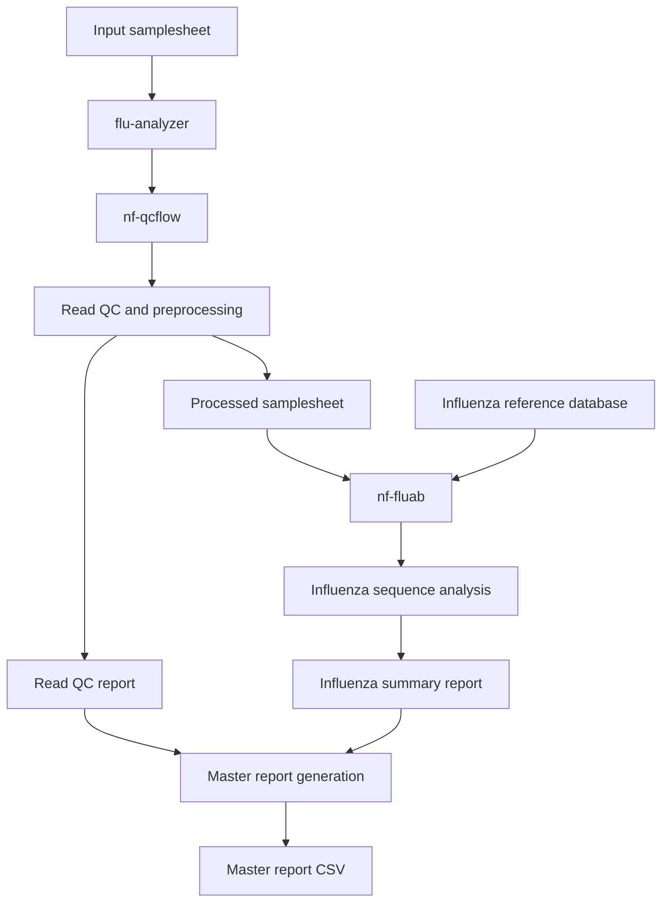

# flu-analyzer

**Integrated influenza A and B NGS analysis pipeline**

`flu-analyzer` is a workflow launcher that integrates read quality control, preprocessing, and influenza sequence analysis using two Nextflow pipelines:

- [nf-qcflow](https://github.com/xiaoli-dong/qcflow) – read quality control and preprocessing.
- [nf-fluab](https://github.com/xiaoli-dong/nf-fluab) – influenza A and B sequence analysis.

The launcher coordinates both workflows, passes the QC-processed samplesheet to the influenza analysis pipeline, and generates a consolidated master report.

Reference database generation is a separate operation managed by [`fluab-reference-db`](https://github.com/xiaoli-dong/fluab-reference-db). The `build_reference_db.sh` wrapper provides an entry point from `flu-analyzer` to that project.

## Workflow overview



The workflow above describes routine sample analysis. Reference database generation is performed separately using `build_reference_db.sh`.

## Features

- Integrated execution of `nf-qcflow` and `nf-fluab`.
- Support for Illumina and Oxford Nanopore sequencing data through the underlying pipelines.
- Configurable development and production environments.
- Configurable Nextflow execution profile.
- Centralized logging and error handling.
- Automatic collection of pipeline and reference database versions.
- Nextflow resume support.
- Consolidated master report combining read QC and influenza analysis results.
- Separate launcher for reference database generation.

## Requirements

- Nextflow >=25.10.4 and Python 3
- Accessible installations of `nf-qcflow` and `nf-fluab`.
- Influenza A/B reference database generated by [`fluab-reference-db`](https://github.com/xiaoli-dong/fluab-reference-db).

Pipeline paths, versions, reference database location, execution profile, and environment-specific settings are configured through the files under `config/`.

## Input

The analysis launcher accepts a CSV samplesheet compatible with `nf-qcflow`.

For example:

```csv
sample,fastq_1,fastq_2,fastq_long
sample01,/data/sample01_R1.fastq.gz,/data/sample01_R2.fastq.gz,NA
sample02,NA,NA,/data/sample02.fastq.gz
sample03,/data/sample03_R1.fastq.gz,/data/sample03_R2.fastq.gz,/data/sample03.fastq.gz
```

The samplesheet supports Illumina paired-end and Oxford Nanopore long-read data. The `fastq_long` column is used for long-read input.

Refer to the [nf-qcflow documentation](https://github.com/xiaoli-dong/qcflow) for the complete samplesheet requirements.

## Configuration

The launcher supports two execution environments:

| Environment | Description |
|---|---|
| `production` | Uses production pipeline installations and configurations. |
| `development` | Uses development pipeline installations and configurations. |

The default environment is `production`.

Configuration is divided into:

- `config/dependencies.config` – pipeline dependencies and shared configuration variables.
- `config/environments/production.config` – production environment settings, including the reference database pipeline path.
- `config/environments/development.config` – development environment settings, including the reference database pipeline path.
- `config/pipelines/nf-qcflow.config` – `nf-qcflow` configuration.
- `config/pipelines/nf-fluab.config` – `nf-fluab` configuration.

The reference database project path is configured using `FLUAB_DB_PIPELINE_DIR` in the selected environment configuration.

## Run influenza analysis

Use `run_flu.sh` to perform routine sample analysis using an existing influenza reference database.

### Usage

```bash
# Run the analysis pipeline using production configuration
bash run_flu.sh samplesheet.csv results/

# Run using development configuration
bash run_flu.sh samplesheet.csv results/ --env development

# Display help
bash run_flu.sh --help

# Display version
bash run_flu.sh --version
```

### Command-line options

| Argument | Description |
|---|---|
| `samplesheet.csv` | Input samplesheet for `nf-qcflow`. |
| `results_dir` | Output directory. |
| `--env production` | Use production configuration (default). |
| `--env development` | Use development configuration. |
| `-h`, `--help` | Display usage information. |
| `-v`, `--version` | Display launcher version. |

## Output structure

The analysis launcher organizes results into separate directories:

```text
results/
├── nf-qcflow/
│   └── ...
├── nf-fluab/
│   └── ...
├── master_report/
│   └── master_report.csv
├── logs/
│   └── pipeline.log
└── run_info.txt
```

| Output | Description |
|---|---|
| `nf-qcflow/` | Read QC and preprocessing results. |
| `nf-fluab/` | Influenza sequence analysis results. |
| `master_report/master_report.csv` | Consolidated analysis report. |
| `logs/pipeline.log` | Launcher and pipeline execution log. |
| `run_info.txt` | Run metadata, pipeline versions, and reference database information. |

## Master report

The workflow combines read QC metrics from `nf-qcflow` and influenza analysis results from `nf-fluab` into:

`master_report/master_report.csv`

The master report provides a consolidated, sample-level summary of read QC and influenza sequence analysis results.

Each row represents one sample and one selected influenza subtype/reference. The report supports both Illumina and Nanopore sequencing data. Samples with multiple detected influenza subtypes (coinfections) or sequencing data from multiple platforms can have multiple rows.

### Report contents

The CSV includes the following information:

- **Sample information:** Sample name, sequencing platform and read type.
- **Read QC metrics:** Input, trimmed and dehosted read counts, total bases, average read lengths and trimming/dehosting percentages.
- **Reference selection:** Reference subtype index, subtype and predicted type or lineage.
- **Segment-level results:** Reference sequence ID, segment length, read count, completeness and mean depth for each of the eight influenza genome segments.
- **Typing and classification:** Segment-specific typing results, percentage identity, query coverage, E-value, clade, proposed subclade, subclade and Nextclade QC status, where applicable.
- **Genome-level metrics:** Average genome completeness and mean depth.
- **Version information:** Reference database version and versions of `nf-fluab`, `nf-qcflow` and `flu-analyzer`.

### Example master report

The following example shows actual output from `master_report.csv`, including Nanopore and Illumina samples, influenza A and B subtypes/lineages, coinfections and partial genome recovery.

```csv
sample,platform,read_type,input_num_reads,input_total_bases,input_avg_len,trimmed_num_reads,trimmed_total_bases,trimmed_avg_len,trimmed_pct,dehosted_num_reads,dehosted_total_bases,dehost
ed_avg_len,dehosted_pct_of_trimmed,ref_subtype_index,ref_subtype,predicted_type_or_lineage,seg1_id,seg1_length,seg1_numreads,seg1_completeness,seg1_meandepth,seg2_id,seg2_length,seg2_num
reads,seg2_completeness,seg2_meandepth,seg3_id,seg3_length,seg3_numreads,seg3_completeness,seg3_meandepth,seg4_id,seg4_length,seg4_numreads,seg4_completeness,seg4_meandepth,seg4_typing,s
eg4_typing_pident,seg4_typing_qcov,seg4_typing_evalue,seg4_clade,seg4_proposedSubclade,seg4_subclade,seg4_nextclade_qc.overallStatus,seg5_id,seg5_length,seg5_numreads,seg5_completeness,s
eg5_meandepth,seg6_id,seg6_length,seg6_numreads,seg6_completeness,seg6_meandepth,seg6_typing,seg6_typing_pident,seg6_typing_qcov,seg6_typing_evalue,seg6_clade,seg6_proposedSubclade,seg6_
subclade,seg6_nextclade_qc.overallStatus,seg7_id,seg7_length,seg7_numreads,seg7_completeness,seg7_meandepth,seg7_typing,seg7_typing_pident,seg7_typing_qcov,seg7_typing_evalue,seg8_id,seg
8_length,seg8_numreads,seg8_completeness,seg8_meandepth,avg_genome_completeness,avg_genome_meandepth,flu_db_ver,nf_fluab_ver,nf_qcflow_ver,flu_analyzer_ver
sample1,illumina,paired,134090,40495180,151.0,128391,35465330,138.1,95.7,128257,35427385,138.1,99.9,1,H3N2,NA,sample1-seg1|illumina|H3N2,2280,46219,100.00,2295.15,sample1-seg2|illumina|H
3N2,2274,14582,99.60,806.926,sample1-seg3|illumina|H3N2,2151,31314,100.00,1738.23,sample1-seg4|illumina|H3N2,1701,21158,100.00,1672.7,NA,NA,NA,NA,G.1,G.1,G.1,good,sample1-seg5|illumina|H
3N2,1497,22412,100.00,2065.6,sample1-seg6|illumina|H3N2,1410,24160,100.00,2182.63,NA,NA,NA,NA,B,B,NA,good,sample1-seg7|illumina|H3N2,982,44610,100.00,6262.5,NA,NA,NA,NA,sample1-seg8|illu
mina|H3N2,838,34896,100.00,5622.69,99.95,2830.80,20261006,2.1.0,1.0.0,1.0.0
sample3_co,illumina,paired,104619,31594938,151.0,97799,26389082,134.9,93.5,72416,19678938,135.9,74.0,1,H1N1,NA,sample3_co-seg1|illumina|H1N1,2280,1912,100.00,102.775,NA,NA,NA,NA,NA,NA,NA
,NA,NA,NA,sample3_co-seg4|illumina|H1N1,1701,4022,100.00,325.517,NA,NA,NA,NA,D,D,D,good,NA,NA,NA,NA,NA,sample3_co-seg6|illumina|H1N1,1410,12046,100.00,1145.54,NA,NA,NA,NA,C.5.1.1,C.5.1.1
,NA,good,sample3_co-seg7|illumina|H1N1,982,64042,96.74,8710.11,NA,NA,NA,NA,sample3_co-seg8|illumina|H1N1,838,8228,100.00,1339.12,62.09,1452.88,20261006,2.1.0,1.0.0,1.0.0
sample3_co,illumina,paired,104619,31594938,151.0,97799,26389082,134.9,93.5,72416,19678938,135.9,74.0,2,H3N2,NA,sample3_co-seg1|illumina|H3N2,2280,5999,100.00,357.349,sample3_co-seg2|illu
mina|H3N2,2274,1950,98.33,111.801,sample3_co-seg3|illumina|H3N2,2151,3690,95.03,208.766,sample3_co-seg4|illumina|H3N2,1701,1015,100.00,79.1864,NA,NA,NA,NA,G.2,G.2,G.2,good,sample3_co-seg
5|illumina|H3N2,1497,2753,98.40,234.614,sample3_co-seg6|illumina|H3N2,1410,1871,100.00,178.174,NA,NA,NA,NA,A.2.2.2,A.2.2.2,NA,good,NA,NA,NA,NA,NA,NA,NA,NA,NA,sample3_co-seg8|illumina|H3N
2,838,2970,100.00,472.13,86.47,205.25,20261006,2.1.0,1.0.0,1.0.0
sample9,illumina,paired,128722,37030505,143.8,124201,35861368,144.4,96.5,8028,2275122,141.7,6.5,1,H3N2,NA,sample9-seg1|illumina|H3N2,2280,2307,99.96,130.92,NA,NA,NA,NA,NA,sample9-seg3|il
lumina|H3N2,2178,655,59.83,38.1878,sample9-seg4|illumina|H3N2,1701,415,100.00,35.0253,NA,NA,NA,NA,K,K,K,good,sample9-seg5|illumina|H3N2,1497,570,100.00,54.2705,sample9-seg6|illumina|H3N2
,1410,499,100.00,49.7085,NA,NA,NA,NA,C,C,NA,good,sample9-seg7|illumina|H3N2,982,9640,100.00,1418.63,NA,NA,NA,NA,sample9-seg8|illumina|H3N2,838,484,99.40,83.9869,82.40,226.34,20261006,2.1
.0,1.0.0,1.0.0
sample9,nanopore,single,45881,21202463,462.1,33391,15766143,472.2,72.8,593,449055,757.3,1.8,1,H3N2,NA,NA,NA,NA,NA,NA,NA,NA,NA,NA,NA,NA,NA,NA,NA,NA,NA,NA,NA,NA,NA,NA,NA,NA,NA,NA,NA,NA,NA,
sample9-seg5|nanopore|H3N2,1497,34,99.93,14.7388,NA,NA,NA,NA,NA,NA,NA,NA,NA,NA,NA,NA,NA,sample9-seg7|nanopore|H3N2,982,281,99.90,192.868,NA,NA,NA,NA,sample9-seg8|nanopore|H3N2,838,29,97.
26,15.4726,37.14,27.88,20261006,2.1.0,1.0.0,1.0.0
```

In this example:

- Nanopore and Illumina results are included in the same report.
- `sample3_co` and `sample4_co` each have separate rows for H1N1 and H3N2, representing coinfections.
- Samples with partial segment recovery are retained, with unavailable segment results represented by `NA`.
- The same sample name may appear in multiple rows when multiple subtypes or platforms are analyzed.

The report also includes pipeline and reference database version information to support result traceability.

## Logging and reproducibility

Each analysis execution records:

- `flu-analyzer` version.
- `nf-qcflow` version.
- `nf-fluab` version.
- Reference database version and resolved path.
- Selected execution environment.
- Analysis date and input samplesheet.

Nextflow is invoked with `-resume` for both workflows, allowing completed tasks to be reused when the same work directory and task inputs are available.

Execution logs are written to:

```text
results/logs/pipeline.log
```

Run metadata are written to:

```text
results/run_info.txt
```

## Build the influenza reference database

Reference database generation is managed separately by the [`fluab-reference-db`](https://github.com/xiaoli-dong/fluab-reference-db) project.

The `build_reference_db.sh` wrapper in `flu-analyzer` selects the development or production reference database project installation and forwards the remaining command-line arguments to its `bin/run_pipeline.sh` launcher.

Building or updating the reference database is independent of routine sample analysis. This operation does not run `run_flu.sh`.

### Usage

Display available options:

```bash
bash build_reference_db.sh --help
```

Build using the development environment:

```bash
bash build_reference_db.sh --env development --outdir outdir
```

Build using the production environment:

```bash
bash build_reference_db.sh --env production --outdir outdir
```

### Pass options to the reference database pipeline

Arguments other than `--env` are forwarded to `fluab-reference-db/bin/run_pipeline.sh`.

For example, to limit downloads to 500 records per taxon:

```bash
bash build_reference_db.sh \
    --env development \
    --outdir outdir \
    --max 500
```

The reference database launcher supports additional options, including:

| Option | Description |
|---|---|
| `--outdir` | Output directory for the database build. |
| `--batch` | Metadata page size and sequence batch size. |
| `--seq-limit` | Maximum number of sequences per BV-BRC request. |
| `--max` | Maximum number of records per taxon. |

Refer to the [`fluab-reference-db` documentation](https://github.com/xiaoli-dong/fluab-reference-db) for the complete list of supported build options.

The reference database project path is configured separately for each environment using `FLUAB_DB_PIPELINE_DIR` in:

- `config/environments/development.config`
- `config/environments/production.config`

The generated database can then be configured for use by `run_flu.sh` through the corresponding environment configuration.

## Related repositories

- [nf-qcflow](https://github.com/xiaoli-dong/qcflow) – read QC and preprocessing.
- [nf-fluab](https://github.com/xiaoli-dong/nf-fluab) – influenza A/B sequence analysis.
- [fluab-reference-db](https://github.com/xiaoli-dong/fluab-reference-db) – influenza A/B reference database generation.

## Author

Xiaoli Dong  
ProvLab – Alberta Precision Laboratories  
Calgary, Alberta, Canada

## License

MIT License. See [LICENSE](LICENSE) for details.
